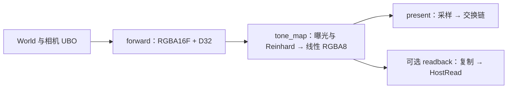

# 离屏场景与后处理

mesh demo 将 ECS 场景渲染到 HDR 纹理，再应用曝光与 Reinhard 色调映射，最后呈现到交换链。实现依据 [ADR-0015](../product/adr/ADR-0015-offscreen-post-process.md)，所有 shader 源位于 [内置 shader](../../main/builtin_assets/shaders/README.md)。

## 运行

在仓库根目录完成构建后运行：

```bash
./bin/debug/rover --scene main/builtin_assets/scenes/demos/primitives.rscene
./bin/debug/rover --scene main/builtin_assets/scenes/demos/primitives.rscene --exposure 2
./bin/debug/rover --scene main/builtin_assets/scenes/demos/primitives.rscene --tone-map none
```

| 参数 | 行为 |
|------|------|
| `--exposure value` | 有限正数，默认 1 |
| `--tone-map reinhard\|none` | 默认 Reinhard；none 将曝光后的值限制在 0–1 |
| `--frames count` | 正整数，达到帧数后退出 |
| `--verify-rendering` | 每帧检查 RGBA8 回读的背景、几何与 alpha |
| `--capture path.ppm` | 保存最后一帧的映射结果；未指定帧数时运行一帧 |
| `--resize-test` | 第二帧后请求 960×540，并验证目标尺寸及代数发生变化；默认 8 帧，至少 6 帧 |

这些后处理参数用于 mesh demo。PPM 保存线性 RGB 字节，与 RGBA8 中间目标数值一致；窗口通过 sRGB 交换链附件编码显示。回读与截图启用时会等待 GPU 完成。

`--verify-rendering` 适用于当前五个示例：画面应同时包含背景与几何。检查使用背景 `(0.05, 0.07, 0.10)` 经曝光和映射后的期望值，允许每通道 2 个字节单位的误差，并要求所有 alpha 为 255。这一检查覆盖离屏写入与采样链；复杂场景的语义正确性仍需对应图像或专项断言。

## Pass 与同步



`PostProcessPipeline::add_passes` 按 present、tone_map、forward、可选 readback 的顺序登记；Frame Graph 编译后按 forward → tone_map → present → readback 执行。图中声明 HDR/LDR 颜色写入与采样、深度附件、相机 UniformRead、网格 VertexRead/IndexRead，以及回读 TransferRead/TransferWrite/HostRead。自动 barrier 在 pass 前完成布局与访存转换。

HDR 使用 RGBA16F，深度使用 D32。色调映射 pass 采样 HDR，计算 `color * exposure`，启用 Reinhard 时输出 `color / (1 + color)`。RGBA8 输出同时供呈现和读回使用。纹理与采样器独立绑定，对应 Vulkan SAMPLED_IMAGE / SAMPLER。

## 所有权与尺寸变化

| 位置 | 职责 |
|------|------|
| `services/graphics/post_process_pipeline.{h,cpp}` | shader、全屏 pipeline、render pass、每交换链图像的 HDR/depth/LDR、framebuffer、bind group、可选回读缓冲 |
| `main/mesh_demo.cpp` | World、网格缓存、逐图像相机 UBO、场景绘制回调与运行验证 |
| `platform/linux/window.{h,cpp}`、`event_pump.cpp` | SDL 窗口与 drawable 像素尺寸事件 |
| `drivers/vulkan/graphics_device_vulkan_frame.cpp` | begin_frame 尺寸检测、交换链获取和重建 |
| `misc/cmake/RoverShader.cmake` | Slang → SPIR-V → C++ 头文件；依赖本地 slangc target |

调用顺序为 `begin_frame → prepare → add_passes → compile/execute → end_frame/present`；启用回读时随后调用 `read_pixels`。`prepare` 检查尺寸、格式和交换链图像句柄；稳定帧直接复用资源，变化时等待设备空闲、建立完整候选资源，成功后替换旧资源。失败释放候选资源并保留上一代目标，调用方停止该帧渲染。代数只在成功替换后递增。

窗口接口尺寸以 drawable 像素为单位，零尺寸窗口跳过帧。驱动记住创建交换链时的请求尺寸，检测窗口变化，并保留 acquire/present 的过期处理。相机 UBO 按获取到的交换链图像更新，避免覆盖其他在途帧的数据。释放时先等待 GPU 完成，再销毁绑定、framebuffer、纹理和相关 pipeline；设备最后关闭。

## 验证

```bash
ctest --test-dir build --output-on-failure
VK_LAYER_VALIDATE_SYNC=1 ./bin/debug/rover \
  --scene main/builtin_assets/scenes/demos/primitives.rscene \
  --frames 8 --verify-rendering --capture /tmp/rover-primitives.ppm
VK_LAYER_VALIDATE_SYNC=1 ./bin/debug/rover \
  --scene main/builtin_assets/scenes/demos/primitives.rscene \
  --frames 8 --verify-rendering --resize-test
```

C++ 测试覆盖逐图像资源、稳定帧复用、尺寸/格式/图像集变化、每个重建分配点的失败回滚、依赖销毁顺序、图排序与读回导出。Python 测试覆盖 SPIR-V 头文件生成、错误输入与源发现。GPU 验证使用五个内置场景、曝光 0.5/1/2、映射开关和尺寸重建；现有 triangle 与 frame-graph demo 用于回归。

2026-11-07：Intel Iris Xe / Vulkan 1.3 上，五个场景各 8 帧通过像素回读；曝光 0.5、1、2 的平均 RGB 分别为 18.929、33.279、54.634，关闭 Reinhard 为 44.303。缩放从 1280×720 到 960×540，目标代数从 1 到 2，缩放后六帧均通过回读。triangle 和 frame-graph 各 8 帧通过。上述运行无 Vulkan 验证错误或 SYNC-HAZARD；环境中的 OBS 隐式层产生一条既有扩展类型警告。七个生成的 SPIR-V 均通过 `spirv-val --target-env vulkan1.3`。

## 后续工作

- 为资源多次写入引入版本。
- 增加瞬态资源分配与生命周期复用。
- 扩展到 mip/layer 子资源与更多后处理 pass。
- 接入 shader 优化插件时一并登记源码依赖。
